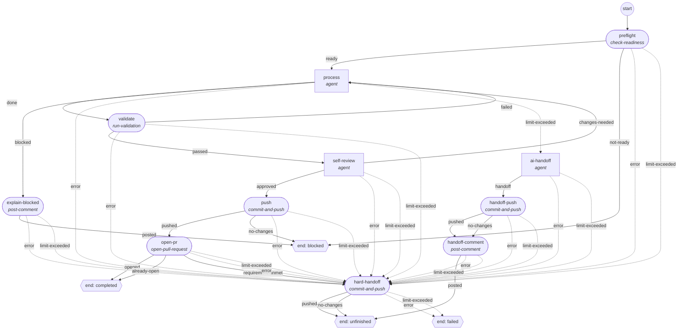
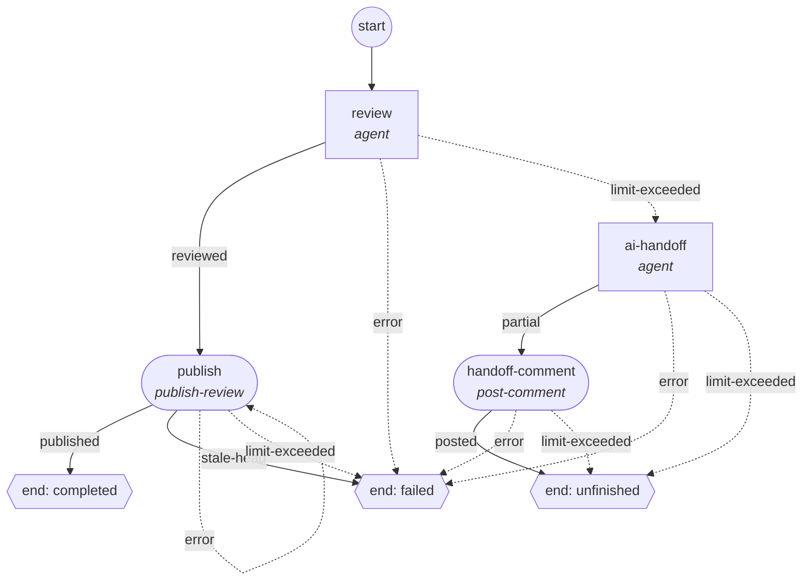

# PROTOTYPE: one YAML contract for implementation and standalone review

Throwaway prototype for [Can one YAML contract express implementation and standalone review with explicit failure paths?](https://github.com/lbacik/coding-agent/issues/284), part of the map [Design: declarative step workflows compiled from YAML to LangGraph](https://github.com/lbacik/coding-agent/issues/276). Not production code and not an accepted contract until the ticket's resolution says so.

**Question.** Using the contracts resolved in #279–#283 and #286, can one candidate YAML syntax express an implementation Workflow (issue in, pull request out) and a standalone review Workflow (existing pull request in, review out), each with start, instructions/skills, model policy, input/output handoffs, bounded repetition, ordinary completion, exceeded step limits, AI-assisted Handoff and runtime-only failure endings, without the author encoding runtime internals or executable expressions, and with both using the same step interface and no process-specific runtime branch?

## Files

| File | What it is |
| --- | --- |
| `workflows.yaml` | The candidate syntax: one operator file with the `implement` and `review` Workflows. |
| `prompts/` | Stub operator prompt files referenced by the YAML (content irrelevant here). |
| `invalid/*.yaml` | 35 invalid configurations, one per validation rule, each naming the expected error. |
| `validate_prototype.py` | Lightweight static validator and compile view, written only to check that every accepted rule is decidable from this syntax. |
| `demo_template.html`, `build_demo.py` | Source of the walkthrough page. |
| `trace_scenarios.js` | Runs every guided scenario headlessly (`node trace_scenarios.js workflow-demo.html`); source of the traces below. |
| `workflow-demo.html` | Self-contained walkthrough: open it in a browser, pick a Workflow, press scenario or free-play buttons. |

## Run

```sh
python validate_prototype.py workflows.yaml --graph    # valid + LangGraph mapping per #281
python validate_prototype.py --invalid                 # every invalid case rejected with its expected message
python build_demo.py && open workflow-demo.html        # rebuild and open the walkthrough
```

Needs only PyYAML (the project venv has it). The page needs nothing.

## Candidate syntax in one screen

- **File:** `version: 2`, `target`, `models`, `workflows.<id>`; each Worker runs one Workflow. All keys kebab-case.
- **Workflow:** `model` (the Attempt's one Pinned Model), `input` (`type`, `label`, `require-all`/`require-any`/`exclude`, `drafts` for PRs, `skip-open-agent-pr` for issues), `limits` (Attempt Ceiling, all four meters), `max-parallel-subagents`, `outcomes.<Terminal Outcome>.labels`, `start`, `defaults` (`max-executions`, `routes` for reserved results only), `steps`.
- **Every step:** exactly one executor (`agent:` block or `operation: <catalog name>` with parameters under `with:`), plus the same control keys: `max-executions`, `routes`, and for agent steps `limits` (Step Allowance) and `reserved`.
- **Agent block:** `instructions` (ordered `skill:`/`prompt:` items), `tools` (the five groups), `inputs` (`<step>.<result>.<field>`, `<step>.facts`, or `{optional: <ref>}`), `results` (name → field → type: `document`, `string`, `integer`, `boolean`, `evidence-ref`, `{list: T}`, `{enum: [...]}`).
- **Route target:** a step id or `{end: completed|blocked|unfinished|failed}`.
- **Operation parameters:** `with.body` (a reference to a `document` field; required by `open-pull-request`, `publish-review` and `post-comment`), `with.draft`, `with.requires: [run-validation: passed]`. The pull-request title is a fixed runtime template over the Target Issue title. There is no facts-mode comment: the runtime's terminal comment already reports the Attempt facts.

## Graphs (dashed = runtime-reserved result)

### implement



### review



## Execution traces

Produced by the walkthrough's pure simulation module (same module the page uses). `#n` is the Step Execution number of that step; "writes" exclude the runtime's finalisation writes (terminal comment, Selection Label removal, end labels, unassignment), which every ending performs.

```text
implement / Happy path: completed
    execs: preflight#1=ready, process#1=done, validate#1=passed, self-review#1=approved, push#1=pushed, open-pr#1=opened
    writes: push:landed, pull request:landed
implement / Validation keeps failing: unfinished
    execs: preflight#1=ready, process#1=done, validate#1=failed, process#2=done, validate#2=failed, process#3=done, validate#3=failed, ai-handoff#1=handoff, handoff-push#1=pushed, handoff-comment#1=posted
    writes: push:landed, comment:landed
implement / Self-review never approves: unfinished
    execs: preflight#1=ready, process#1=done, validate#1=passed, self-review#1=changes-needed, process#2=done, validate#2=passed, self-review#2=changes-needed, process#3=done, validate#3=passed, hard-handoff#1=pushed
    writes: push:landed
implement / Process over budget: unfinished
    execs: preflight#1=ready, process#1=limit-exceeded, ai-handoff#1=limit-exceeded, hard-handoff#1=pushed
    writes: push:landed
implement / Model says blocked: blocked
    execs: preflight#1=ready, process#1=blocked, explain-blocked#1=posted
    writes: comment:landed
implement / Issue edited mid-run: drift
    execs: preflight#1=ready, process#1=done
    writes: -
implement / Worker crash: interrupted
    execs: preflight#1=ready, process#1=(interrupted by process loss — not a Step Result)
    writes: -
review / Happy path: completed
    execs: review#1=reviewed, publish#1=published
    writes: review:landed
review / Publish retried: failed
    execs: review#1=reviewed, publish#1=error, publish#2=error
    writes: -
review / Head moved at write time: failed
    execs: review#1=reviewed, publish#1=stale-head
    writes: review:not-performed (stale-head)
review / Review over budget: unfinished
    execs: review#1=limit-exceeded, ai-handoff#1=partial, handoff-comment#1=posted
    writes: comment:landed
review / Foreign push: drift
    execs: review#1=reviewed
    writes: -
review / Operator cancels: canceled
    execs: review#1=(canceled — not a Step Result)
    writes: -
```

Notable behaviour visible in the traces:

- *Validation keeps failing:* `process` is refused on its fourth entry (no Step Execution, `execution-ceiling` fact) and routing follows `process.limit-exceeded` to `ai-handoff`.
- *Self-review never approves:* the third entry into `self-review` is refused; its `limit-exceeded` comes from `defaults`, so the Hard Handoff runs, not the AI-assisted one.
- *Process over budget:* the AI-assisted Handoff draws on its own reserve; when that runs out it falls to the Hard Handoff, which needs no model.
- *Issue edited / foreign push / crash / cancel:* runtime-only endings; no Route is involved and the YAML cannot select them.

## Validation behaviour

`python validate_prototype.py --invalid` rejects all 35 cases (strict YAML, structure, Routes, ends, unsupported constructs, graph, limits arithmetic, input type, tools, payload/reference typing). One rule needed a refinement to avoid false rejections: in the required-input proof (#281 point 10), an Execution Ceiling refusal edge carries "this step has run at least once", because a refusal implies earlier executions. Without it, `ai-handoff` reading the required `process.facts` would be rejected.

## Evaluation and open points

Owner-accepted (2026-11-11, live review of this prototype):

1. Kebab-case keys throughout and `version: 2`.
2. Operation parameters under `with:`; the step-level control keys are shared by `agent` and `operation` steps.
3. Compact payload field types instead of literal JSON Schema.
4. Inputs as `<step>.<result>.<field>` / `<step>.facts`, optional as `{optional: <ref>}`.
5. Several Workflows per file; each Worker runs one.
6. `post-comment` loses its `facts` mode (amends the #280 catalog); a Hard Handoff is `commit-and-push` and/or a Workflow End.
7. `open-pull-request` takes its title from a fixed runtime template over the Target Issue title; YAML and the model cannot set it.
8. A Hard Handoff step overriding a default `limit-exceeded` that would target itself is accepted authoring cost; the validator names the cycle.
9. Inputs read the latest Step Execution of the named step, even from an earlier loop round.

The resolution comment on #284 records the full decision.
